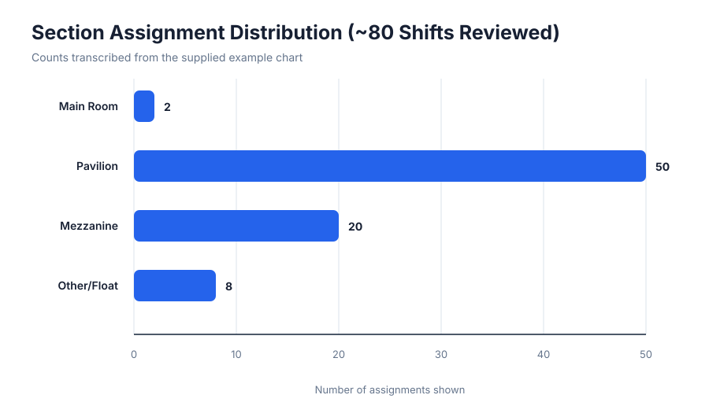

# Staffing Records Visual Demo

Fast demonstration of how staffing arrangements from paper records or PDFs can be presented as clear, reviewable charts.

[Open the visual demo](https://ruddirodriguez.github.io/staffing-records-visual-demo/)

## Evidence note

Original paper records and PDFs were not supplied for this demonstration. Values were transcribed from the provided example charts. Results show presentation quality only; they do not prove document-extraction accuracy.

## Included results

- Visual demo page
- Three chart files
- Three result tables in CSV format
- Client proposal

No Python source code is published in this repository.

